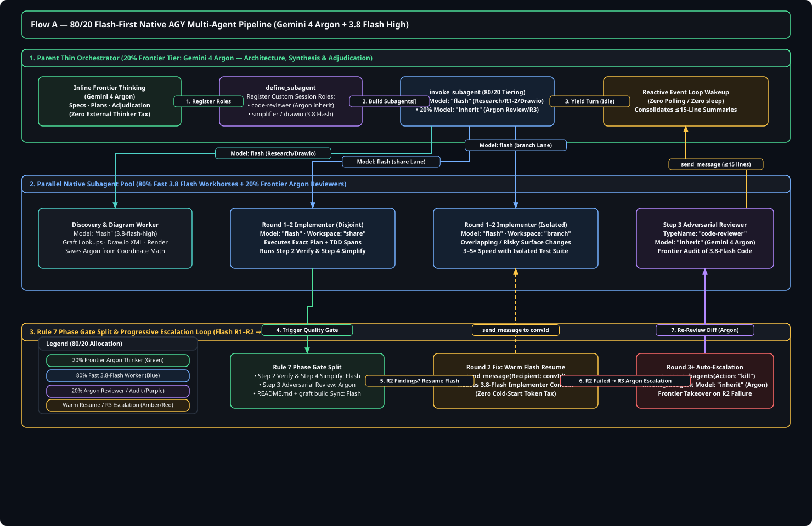
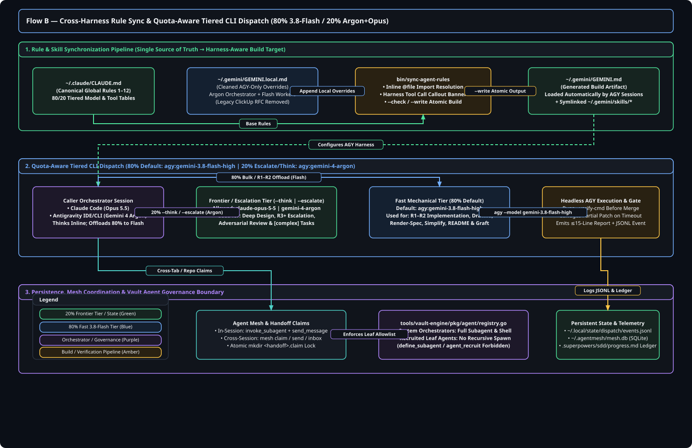
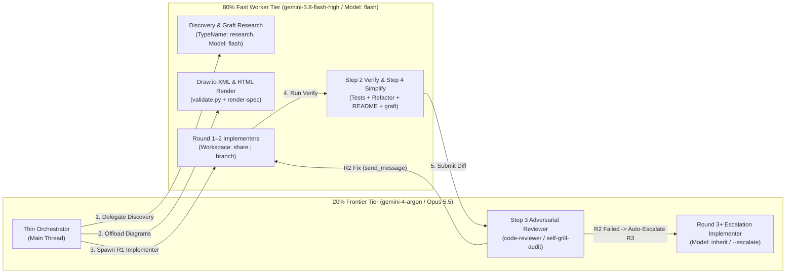

# AGY Gemini 4 Argon & Native Multi-Agent Skill Upgrade (80/20 Flash-First Pipeline)

**Date:** 2026-10-13 · **Author:** Antigravity (`gemini-4-argon`) · **Status:** Approved Design Spec · **Scope:** `ps-skills` (`bin/`, `skills/`, `tools/`) + Global Rules & Skills (`~/.claude/`, `~/.gemini/`)

Frontier Orchestrator &amp; Review Tier (20%)

Gemini 4 Argon + Opus 5.5

Inline thinking, specs, plans, adversarial review &amp; R3+ escalation

Fast Execution Workhorse Tier (80%)

Gemini 3.8 Flash High

Research, Draw.io XML, R1–R2 implementation, tests &amp; simplify

Native AGY Subagent Primitives

4 Core Tools

<code>invoke_subagent</code> · <code>define_subagent</code> · <code>send_message</code> · <code>manage_subagents</code>

Architecture Diagram Validation

Score: 0 / 0

0 through-vertex · 0 crossings · 0 overlaps (both decoupled flows)

## Decisions (batch-grill, 2026-10-13) Locked Architecture

<strong>Three Foundational Decisions + 80/20 Flash-First Tuning Locked</strong>

All architectural trade-offs were resolved prior to specification authoring. This specification governs the coordinated upgrade across both the <code>ps-skills</code> repository and global agent rules/skills in <code>~/.claude/</code> and <code>~/.gemini/</code>.

1. **Coordinated Dual-Surface Scope (`ps-skills` + Global `~/.claude/` & `~/.gemini/`)**:
   - Upgrade both the `ps-skills` repository (`bin/dispatch-agy-worker`, `bin/dispatch-thinker`, `bin/sync-agent-rules`, `tools/vault-engine/pkg/agent/registry.go`, `skills/*/SKILL.md`, `README.md`) **and** global rules/skills (`~/.claude/CLAUDE.md`, `~/.gemini/GEMINI.local.md`, `subagent-driven-development`, `writing-plans`, `brainstorming`, `self-grill-audit`, `task-decomposition`, `agent-execution-standards`) in one coordinated pass.
2. **Two-Tier AGY Model Routing (20% Frontier `gemini-4-argon` / `Claude Opus 5.5` + 80% Fast Worker `gemini-3.8-flash-high`)**:
   - **Frontier Tier (`gemini-4-argon` & `claude-opus-5-5`)**: Treat `Gemini 4 Argon` (`gemini-4-argon`) as a first-class frontier thinker, orchestrator, and adversarial reviewer alongside `Claude Opus 5.5`. Sessions already running on `gemini-4-argon` or `Claude Opus 5.5` perform architectural thinking, brainstorming, spec writing, and plan adjudication **inline on the main thread** without shelling out to `dispatch-thinker`. External `bin/dispatch-thinker` (`--think` / `--capability deep-design-v1`) accepts both `claude-opus-5-5` and `gemini-4-argon` (failing closed with exit code `12` on any non-frontier model).
   - **Fast Worker Tier (`gemini-3.8-flash-high` / `Model: "flash"`)**: Keep `gemini-3.8-flash-high` as the default bulk/mechanical workhorse for `dispatch-worker --agent agy` (`DISPATCH_ROUTING_PREFERENCE="agy:gemini-3.8-flash-high"`) and `Model: "flash"` for native AGY subagents performing codebase research, `graft` queries, `.drawio` XML generation/validation, HTML spec rendering, Round 1–2 plan implementation, test verification, and `/simplify` refactoring.
3. **Native `invoke_subagent` First in AGY + Warm Fix Loops via `send_message`**:
   - When executing inside Antigravity (`agy`), orchestrators prioritize native in-session subagent tools (`invoke_subagent`, `define_subagent`, `send_message`, `manage_subagents`) with `Workspace: "share"` (for parallel disjoint file sets) or `Workspace: "branch"` (for overlapping files or risky surface changes).
   - During `subagent-driven-development` fix rounds (`R ≤ 2` on Flash), the orchestrator calls `send_message(Recipient: "<implementer-conversation-id>", Message: "...")` to resume the existing idle implementer subagent with warm context instead of respawning from scratch. On Round 3 (`R ≥ 3`) or `[complex]`/`[architectural]` tasks, the orchestrator terminates the Flash subagent via `manage_subagents(Action: "kill")` and auto-escalates to a fresh `gemini-4-argon` (`Model: "inherit"`) subagent.
   - Preserve `bin/dispatch-agy-worker` for cross-harness offloading from Claude Code and headless batch jobs.

---

## Decoupled Production Architecture Diagrams Score: 0 Verified

Per Global Rule 6 & Rule 7 (`drawio-skill` production standards), the architecture is decoupled into two distinct, non-overlapping visual flows with explicit `<rect>` background pills (`labelBackgroundColor=#10141b`) on every connector label and verified via `validate.py --score` (`score: 0`).

### Flow A: Fast Real-Time In-Session Native AGY Multi-Agent Pipeline

*Source Artifacts:* [`agy-native-multiagent-flow.drawio`](file:///Users/pasitnusso/ps-skills/docs/superpowers/specs/assets/agy-native-multiagent-flow.drawio) · [`agy-native-multiagent-flow.drawio.svg`](file:///Users/pasitnusso/ps-skills/docs/superpowers/specs/assets/agy-native-multiagent-flow.drawio.svg)

### Flow B: Cross-Harness Rule Synchronization, Tiered CLI Dispatch & Governance Loop

*Source Artifacts:* [`cross-harness-dispatch-sync-flow.drawio`](file:///Users/pasitnusso/ps-skills/docs/superpowers/specs/assets/cross-harness-dispatch-sync-flow.drawio) · [`cross-harness-dispatch-sync-flow.drawio.svg`](file:///Users/pasitnusso/ps-skills/docs/superpowers/specs/assets/cross-harness-dispatch-sync-flow.drawio.svg)

---

## Maximizing `gemini-3.8-flash-high` (`Model: "flash"`) Utilization (80/20 Flash-First Pipeline) Token &amp; Speed Optimization

<strong>Why 80/20 Flash-First Works Without Quality Loss</strong>

Because <code>brainstorming</code> and <code>writing-plans</code> run on the Frontier Tier (<code>gemini-4-argon</code> or <code>Claude Opus 5.5</code>) and produce concrete specifications with exact <code>file:line</code> spans and TDD test cases, 80%+ of downstream execution is well-bounded mechanical synthesis. Routing those bounded tasks to <code>gemini-3.8-flash-high</code> (<code>Model: "flash"</code>) yields <strong>3–5× faster turnaround</strong> while preserving scarce Frontier Argon/Opus quota for adversarial code review and Round 3+ escalations.

### 80/20 Flash-vs-Argon Allocation Matrix

| Pipeline Stage / Skill | Target Role | In-Session AGY (`invoke_subagent`) | External CLI (`dispatch-worker`) | Rationale |
| :--- | :--- | :--- | :--- | :--- |
| **1. Exploration & Fact-Lookup** (`brainstorming`, `batch-grill`, `graft` queries) | `research` subagent | `TypeName: "research"`, `Model: "flash"`, `Workspace: "inherit"` | `dispatch-worker --agent agy --model gemini-3.8-flash-high` | Fast multi-file reading and `graft ask`/`graft callers` traversal; parent Argon thread only synthesizes findings. |
| **2. Diagram & Spec Asset Generation** (`drawio-skill`, `render-spec`) | Diagram / Asset Worker | `TypeName: "self"`, `Model: "flash"`, `Workspace: "inherit"` | `dispatch-worker --agent agy --model gemini-3.8-flash-high` | Offloads verbose `.drawio` XML coordinate math, `validate.py --score` loops, `.drawio.svg` export, and `render-spec-md.sh`. |
| **3. Plan Implementation — Rounds 1 & 2** (`subagent-driven-development`, `epic-run`) | Feature Implementer (R1–R2) | `TypeName: "self"`, `Model: "flash"`, `Workspace: "share"` or `"branch"` | `dispatch-worker --agent agy` (default `gemini-3.8-flash-high`) | `writing-plans` provides exact `file:line` spans and tests; Flash completes 80%+ of tasks at 3–5× speed. R2 resumes warm via `send_message`. |
| **4. Plan Implementation — Round 3+ Escalation** (`subagent-driven-development`, `epic-run`) | Escalated Implementer (R3+ or `[complex]`) | `TypeName: "self"`, `Model: "inherit"` (`gemini-4-argon`), `Workspace: "branch"` | `dispatch-worker --agent agy --escalate` (`gemini-4-argon`) | Triggered automatically when Round 2 fails verification/review or task is tagged `[complex]` / `[architectural]`. |
| **5. Phase Gate Step 2 (Verify) & Step 4 (Simplify)** (Rule 7 Quality Gate) | Test Runner / Simplifier / Doc Sync | `TypeName: "self"`, `Model: "flash"`, `Workspace: "inherit"` | `dispatch-worker --agent agy --model gemini-3.8-flash-high` | Runs test suites, `/simplify` cleanup, `README.md` sync, and `graft build` without burning Frontier quota. |
| **6. Phase Gate Step 3 (Adversarial Review)** (`self-grill-audit`, `code-reviewer`) | Plan Auditor / Code Reviewer | Custom `define_subagent` (`code-reviewer`), `Model: "inherit"` (`gemini-4-argon`) | `dispatch-thinker --agent agy --model gemini-4-argon` | Reviewer MUST hold Frontier reasoning over `3.8-flash`'s implementation diff to catch subtle bugs and spec drift. |

---

## Three Architectural Approaches Considered Trade-Off Analysis

| Dimension | Approach 1: Dual-Harness Native Orchestration + 80/20 Argon/Flash Tiering *(Recommended)* | Approach 2: CLI-Wrapper Only Upgrade (`dispatch-worker` Only) | Approach 3: AGY-Only Native Replacement (Drop CLI Workers) |
| :--- | :--- | :--- | :--- |
| **Core Mechanism** | Uses native `invoke_subagent` / `define_subagent` / `send_message` inside AGY with 80/20 Flash/Argon tiering, while upgrading `dispatch-agy-worker` & `dispatch-thinker` for cross-harness Claude Code calls. | Keeps all subagent orchestration through shell calls to `dispatch-worker --agent agy`, merely adding `gemini-4-argon` to CLI flags. | Replaces all `dispatch-worker` references in skills with AGY-only `invoke_subagent` calls. |
| **Cold-Start & Fix-Loop Cost** | **Lowest**: `send_message` resumes idle R1 Flash implementers in R2 with zero cold-start overhead; R3 escalates cleanly to Argon. | **High**: Every CLI invocation spawns a fresh headless process and re-reads the repository tree from scratch. | **Low in AGY, Broken in Claude Code**: Claude Code cannot call `invoke_subagent` across providers without `dispatch-worker`. |
| **Workspace Isolation** | Uses native `Workspace: "share"` (zero-copy git worktree) and `Workspace: "branch"` in AGY, plus `--isolated` in CLI mode. | Relies solely on temporary git worktree copies created by Python wrapper scripts. | Loses `--isolated` salvage patch protection for headless batch runs. |
| **Cross-Harness Compatibility** | **100% Dual-Harness**: Works seamlessly in both Antigravity (`agy`) and Claude Code (`claude`). | Works in both, but wastes AGY's native reactive event loop and warm subagent messaging. | **Breaks Claude Code** workflows that offload bulk implementation to AGY quota. |
| **Verdict** | **SELECTED** — Maximizes speed, quota longevity, and native capability across both harnesses. | **Rejected** — Fails to leverage `invoke_subagent`, `define_subagent`, `send_message`, or `Workspace: "share"`. | **Rejected** — Violates dual-harness parity between Claude Code and Antigravity. |

---

## Exact File-by-File Change Specification 3 Implementation Lanes

<strong>Parallel Lane Partitioning (Disjoint File Sets)</strong>

The implementation is partitioned into three disjoint lanes (<strong>Lane A: CLI &amp; Go Engine</strong>, <strong>Lane B: <code>ps-skills</code> Skill Markdown</strong>, <strong>Lane C: Global Rules &amp; Core Superpowers Skills</strong>) so three implementer subagents can execute concurrently without merge conflicts.

### Lane A — `ps-skills` CLI Binaries & Go Vault Engine

#### A1. [`bin/dispatch-agy-worker`](file:///Users/pasitnusso/ps-skills/bin/dispatch-agy-worker#L38-L62)
- **Lines 38–62 (Model Constants & Defaults)**:
  - Add `DEFAULT_AGY_WORKER_MODEL = os.environ.get("AGY_WORKER_MODEL", "gemini-3.8-flash-high")` and `DEFAULT_AGY_THINK_MODEL = os.environ.get("AGY_THINK_MODEL", "gemini-4-argon")`, plus `AGY_THINK_MODEL_NAMES = ("gemini-4-argon", "argon", "gemini-4-argon-thinking")`.
- **Lines 295–350 (`normalize_model_name`, `resolve_agent_effort`)**:
  - In `normalize_model_name(agent, model)`: preserve `normalize_model_name("agy", None) -> None` when no model is explicitly forced (so existing `build_agent_command` argv tests that expect `agy` without `--model` when `chosen_model=None` continue to pass). When a model string is provided for `agent == "agy"`, map aliases `"argon"` / `"gemini-4-argon"` $\to$ `"gemini-4-argon"`, and `"flash"` / `"3.8-flash"` / `"gemini-3.8-flash-high"` $\to$ `"gemini-3.8-flash-high"`.
  - In `resolve_agent_effort(agent, effort, is_thinking=False)`: support `AGY_THINK_EFFORT` (default `"medium"` or `DEFAULT_THINK_EFFORT`) when `agent == "agy"` and `is_thinking=True`.
- **Lines 445–485 (`route_thinker`)**:
  - Expand `route_thinker(...)` so `--think` / `deep-design-v1` allows `AGY_THINK_MODEL_NAMES` (`gemini-4-argon`) alongside `CLAUDE_THINK_MODEL_NAMES` (`claude-opus-5-5`).
  - When `--agent agy` or `--model gemini-4-argon` (or `DISPATCH_THINK_PREFERENCE="agy:gemini-4-argon > claude:claude-opus-5-5"`) is passed, check AGY think quota (`min_5h`, `min_weekly`) and route to `("agy", "gemini-4-argon")`, falling back to the second eligible frontier thinker if the first is unavailable or low on quota.
- **Lines 1840–1880 & 2017–2075 (CLI Flags `--escalate` and `deep-design-v1` Gate)**:
  - Add `--escalate` flag (`action="store_true"`, help: `"Escalate implementation task from default 3.8-flash worker tier to frontier gemini-4-argon"`). When `--escalate` is passed with `--agent agy` and no explicit `--model`, set `chosen_model = DEFAULT_AGY_THINK_MODEL` (`gemini-4-argon`).
  - Update `ALLOWED_DEEP_DESIGN_MODELS` at line 2023 and `think_chain` check at line 2045 to allow `AGY_THINK_MODEL_NAMES` (`gemini-4-argon`, `argon`) alongside `CLAUDE_THINK_MODEL_NAMES` (`claude-opus-5-5`, `opus`). Keep fail-closed exit code `12` (`THINKER_UNAVAILABLE`) when any non-frontier model (such as `gemini-3.8-flash-high` or `sonnet`) is requested with `--capability deep-design-v1`.

#### A2. [`bin/dispatch-thinker`](file:///Users/pasitnusso/ps-skills/bin/dispatch-thinker#L1-L13)
- **Lines 1–13 (Header & Documentation Comments)**:
  - Update header comments to document that `dispatch-thinker` routes `--capability deep-design-v1` to Frontier Tier thinkers (`claude-opus-5-5` or `gemini-4-argon`), supports `--agent agy` (`gemini-4-argon`) and `--agent claude` (`claude-opus-5-5`), and fails closed with exit `12` if neither frontier thinker is available.

#### A3. [`bin/sync-agent-rules`](file:///Users/pasitnusso/ps-skills/bin/sync-agent-rules#L80-L95)
- **Lines 81–93 (`generate(source: Path, local: Path) -> str`)**:
  - Inject a concise, deterministic **AGY Harness Tool-Mapping Banner** right after the `<!-- GENERATED ... -->` comment header so any Antigravity session reading `~/.gemini/GEMINI.md` immediately maps Claude-named primitives in shared rules to native AGY tools:
    - `Agent` / `dispatch-worker` (in-session) $\leftrightarrow$ `invoke_subagent` + `define_subagent`
    - `SendMessage` $\leftrightarrow$ `send_message(Recipient: "<conversation-id>")`
    - `ListAgents` / `TaskStop` $\leftrightarrow$ `manage_subagents(Action: "list" | "kill" | "kill_all")`
    - `EnterWorktree` $\leftrightarrow$ `invoke_subagent(..., Workspace: "branch" | "share")`
    - Model tiers: `80% Fast Worker` = `Model: "flash"` (`gemini-3.8-flash-high`); `20% Frontier Thinker/Reviewer` = `Model: "inherit"` (`gemini-4-argon`).

#### A4. [`tools/vault-engine/pkg/agent/registry.go`](file:///Users/pasitnusso/ps-skills/tools/vault-engine/pkg/agent/registry.go#L44-L57)
- **Lines 44–57 (`ValidateManifest` Governance Boundary)**:
  - Clarify the governance comment and add an explicit helper/constant distinguishing **System Orchestrators** (`RecruitedBy == "system"`, which can call `define_subagent`, `invoke_subagent`, `send_message`, and `run_command`) from **Recruited Leaf Agents** (`RecruitedBy != "system"`, which remain forbidden from recursive `define_subagent`, `agent_recruit`, and raw shell execution `run_command`/`shell_exec`/`system_terminal`).
  - Add `"invoke_subagent": true` to `forbiddenTools` for non-system recruited leaf agents so leaf agents cannot recursively fan out subagents (enforcing the single-hop leaf ceiling in code as well as prompts). Update `tools/vault-engine/pkg/agent/registry_test.go` to test that `invoke_subagent` is rejected for non-system recruited leaf agents and allowed for `RecruitedBy: "system"`.

---

### Lane B — `ps-skills` Skill Definitions & Repository Documentation

#### B1. [`skills/agy-worker/SKILL.md`](file:///Users/pasitnusso/ps-skills/skills/agy-worker/SKILL.md#L1-L202)
- **Add "When Running Inside AGY vs External CLI" Decision Matrix at top (after Overview)**:
  - Explicitly state: when the orchestrator is **already inside Antigravity (`agy`)**, prefer native `invoke_subagent` (`Model: "flash"` for R1–R2 implementation/research/diagrams; `Model: "inherit"` for R3 escalation and reviews) with `Workspace: "share"` or `"branch"` and `send_message` for warm R2 fixes.
  - Use `dispatch-worker --agent agy` when offloading from **Claude Code**, running detached background batches (`--batch` / `--detach`), or enforcing an external worktree `--verify-cmd` gate.
- **Document the 80/20 Two-Tier CLI Routing**:
  - Default mechanical tier: `dispatch-worker --agent agy` $\to$ `gemini-3.8-flash-high` (`DISPATCH_ROUTING_PREFERENCE="agy:gemini-3.8-flash-high"`).
  - Escalation tier (Round 3+ or `[complex]` tasks): `dispatch-worker --agent agy --escalate` (or `--model gemini-4-argon`).
  - Frontier thinker tier (`dispatch-thinker` / `--capability deep-design-v1`): allows both `claude-opus-5-5` and `gemini-4-argon`.

#### B2. [`skills/ps-release-workflow-epic-fanout/SKILL.md`](file:///Users/pasitnusso/ps-skills/skills/ps-release-workflow-epic-fanout/SKILL.md#L24-L38)
- **Lines 24–38 (`## Then` section)**:
  - Add guidance for parallel slice spec preparation after `psrw epic fanout`: in AGY, fan out `research` subagents (`Model: "flash"`, `Workspace: "inherit"`) in a single `invoke_subagent` call to gather codebase context per slice idea `I-NNN`, while keeping slice spec synthesis and user decisions on the `gemini-4-argon` / `Opus 5.5` orchestrator thread.

#### B3. [`skills/ps-release-workflow-epic-run/SKILL.md`](file:///Users/pasitnusso/ps-skills/skills/ps-release-workflow-epic-run/SKILL.md#L39-L52)
- **Lines 39–48 (Steps 4 & 5 — Slice Implementation & Review)**:
  - Specify the **80/20 Progressive Escalation** contract per slice:
    - Step 4 (`writing-plans` + `self-grill-audit`): plan authoring and `self-grill-audit` run on Frontier Tier (`gemini-4-argon` / `Opus 5.5`).
    - Step 4 (`subagent-driven-development` task implementation): Round 1 & Round 2 task implementers run on `3.8-flash` (`Model: "flash"` with `Workspace: "share"` for disjoint tasks or `dispatch-worker --agent agy`), resuming via `send_message` on Round 2. Round 3 auto-escalates to `gemini-4-argon` (`Model: "inherit"` or `--escalate`).
    - Step 5 (Independent whole-slice review of `git diff <base> HEAD`): always runs on Frontier Tier (`Model: "inherit"` / `gemini-4-argon` or `Opus 5.5`).

#### B4. [`skills/agent-mesh-coordination/SKILL.md`](file:///Users/pasitnusso/ps-skills/skills/agent-mesh-coordination/SKILL.md#L10-L52)
- **Add "In-Session Native Subagents vs Cross-Session Mesh" Boundary Section**:
  - Clarify when to use AGY native tools vs `mesh` CLI:
    - **Same Session (Intra-Session)**: use `invoke_subagent` (`Workspace: "share"`/`"branch"`), `send_message(Recipient: convId)`, and `manage_subagents(Action: "list")`.
    - **Across Terminal Tabs / Separate Processes / Cross-Repo (Inter-Session)**: use `mesh claim <path> --ttl 300`, `mesh send --to <agent-id>`, and `mesh inbox`.

#### B5. [`skills/handoff/SKILL.md`](file:///Users/pasitnusso/ps-skills/skills/handoff/SKILL.md#L110-L145)
- **Lines 113–140 (Background-Work Check & Harness Primitives)**:
  - Update step `3a` so AGY sessions check both `manage_subagents(Action: "list")` and `manage_task(Action: "list")` (alongside `ListAgents` in Claude Code) before generating a handoff file, and record any active subagent `conversationId`s or detached `dispatch-worker` job IDs in the handoff document.

#### B6. [`skills/agent-olivier/SKILL.md`](file:///Users/pasitnusso/ps-skills/skills/agent-olivier/SKILL.md#L10-L33)
- **Lines 10–33 (Orchestration Principles & Parallel Fan-Out)**:
  - Align with the 80/20 Flash-First Pipeline: set `Model: "flash"` on discovery/extraction leaf subagents (`agent-bestie`, `agent-philip`) for 3–5× faster parallel vault synthesis, while `agent-olivier` (Orchestrator) and `agent-critic` run on `Model: "inherit"` (`gemini-4-argon`).

#### B7. [`README.md`](file:///Users/pasitnusso/ps-skills/README.md#L80-L145)
- **Lines 80–145 (`Multi-Agent External Fan-out` & `Syncing global rules`)**:
  - Update documentation and tables to reflect the **Two-Tier 80/20 Model Routing**:
    - Default worker tier: `agy:gemini-3.8-flash-high` (`--agent agy`).
    - Escalation worker flag: `--escalate` (`agy:gemini-4-argon`).
    - Frontier thinker tier (`dispatch-thinker` / `--capability deep-design-v1`): `claude-opus-5-5` and `gemini-4-argon`.
    - Native AGY multi-agent orchestration (`invoke_subagent`, `define_subagent`, `send_message`, `Workspace: "share"|"branch"`).

---

### Lane C — Global Rules (`~/.claude/CLAUDE.md`, `~/.gemini/GEMINI.local.md`) & Core Skills

#### C1. [`~/.claude/CLAUDE.md`](file:///Users/pasitnusso/.claude/CLAUDE.md#L80-L265)
- **Rule 6 (Lines 84–95 — Multi-lane work & Thin Orchestrator)**:
  - Add explicit dual-harness subagent primitives: in Claude Code use `Agent` (`isolation: worktree`) + `SendMessage`; in Antigravity (`agy`) use `invoke_subagent` (`Workspace: "share"` for disjoint file sets, `Workspace: "branch"` for isolated worktrees), `define_subagent` for custom session-scoped roles (`code-reviewer`, `self-grill-auditor`), and `send_message(Recipient: convId)` to resume idle implementers across fix rounds without cold-start respawn.
  - Under `drawio-skill` & `render-spec` standards (Lines 110–125): specify that `.drawio` XML generation, `validate.py --score` fix-up loops, `.drawio.svg` export, and `render-spec-md.sh` execution should be offloaded to a `Model: "flash"` (`gemini-3.8-flash-high`) subagent or worker.
- **Rule 7 (Lines 127–150 — Phased Quality Gate Split)**:
  - Codify the **80/20 Phase Gate Split**:
    - **Step 2 (Verify)** and **Step 4 (Refactor / `/simplify` / `README.md` sync / `graft build`)** route to `3.8-flash` (`Model: "flash"` or `dispatch-worker --agent agy`).
    - **Step 3 (Adversarial Review — `code-reviewer`, `self-grill-audit`)** routes to Frontier Tier (`gemini-4-argon` via `Model: "inherit"` or `Claude Opus 5.5`).
- **Rule 8 (Lines 152–170 — Two-Tier Model Routing & 80/20 Flash-First Pipeline)**:
  - Update section title and bullets to: `## 8. MODEL ROUTING — Frontier Tier (Claude Opus 5.5 / Gemini 4 Argon) + 80% Fast Worker Tier (Gemini 3.8 Flash High)`.
  - State explicitly:
    1. **Main thread does thinking-heavy work directly when running on Claude Opus 5.5 OR Gemini 4 Argon (`gemini-4-argon`)**: plan mode, brainstorming, writing-plans, design specs, ADRs, and review adjudication happen inline without shelling out to `dispatch-thinker`.
    2. **When NOT running on Opus 5.5 or Gemini 4 Argon (e.g., Haiku, Sonnet, Flash runner models)**: any directive to "think", "analyze with thinker", or plan architecture MUST dispatch via `dispatch-thinker` (`--capability deep-design-v1`), which routes to **Claude Opus 5.5 or Gemini 4 Argon (`--effort medium`)** and fails closed (exit 12) on non-frontier models.
    3. **80/20 Flash-First Execution Default**: Route 80% of bounded work — `research` / `graft` lookups, `.drawio` XML + `render-spec`, Round 1 & Round 2 plan implementation, test verification, and `/simplify` — to `gemini-3.8-flash-high` (`Model: "flash"` in native AGY `invoke_subagent`, or `DISPATCH_ROUTING_PREFERENCE="agy:gemini-3.8-flash-high"` in `dispatch-worker --agent agy`).
    4. **Round 3 Auto-Escalation**: Escalate to `gemini-4-argon` (`Model: "inherit"` in AGY or `dispatch-worker --agent agy --escalate`) or `Claude Opus 5.5` only when Round 2 fails verification/review or a task is tagged `[complex]` / `[architectural]`.
- **Rule 12 (Lines 223–265 — Token Economy & Dual-Harness Tool Mapping Table)**:
  - Add a compact **Dual-Harness Multi-Agent Tool Mapping Table** comparing Claude Code vs Antigravity (`agy`) primitives (`Agent` vs `invoke_subagent`, custom agent `.md` vs `define_subagent`, `SendMessage` vs `send_message`, `ListAgents`/`TaskStop` vs `manage_subagents`, `isolation: worktree` vs `Workspace: "branch"|"share"`).

#### C2. [`~/.gemini/GEMINI.local.md`](file:///Users/pasitnusso/.gemini/GEMINI.local.md#L1-L157)
- **Remove Obsolete ClickUp Zen RFC Rules (Lines 1–127)**:
  - Delete Sections 1–12 (`# ClickUp Zen RFC — The Principles of Organized Work` through `## 12. Communication & Comments`), which are legacy project-management boilerplate that bloat every AGY session context and conflict with `ps-release-workflow` / `herdr-board`.
- **Retain & Upgrade Sections 13–14 into Clean AGY-Only Overrides**:
  - Keep **Visual Companion & Diagram Approvals** and **Skills Parity** notes.
  - Expand **AGY Subagent-First Orchestrator Default (80/20 Argon + Flash Pipeline)**:
    - **Parent Orchestrator (`gemini-4-argon`)**: inline thinking, planning, user interaction, and review adjudication.
    - **80% Fast Subagents (`Model: "flash"` / `gemini-3.8-flash-high`)**: mandatory default for `TypeName: "research"` (`graft` + file discovery), `.drawio` generation/validation (`validate.py --score`), Round 1–2 `TypeName: "self"` task implementers (`Workspace: "share"` for disjoint files, `Workspace: "branch"` for overlapping/risky files), Step 2 test verification, and Step 4 `/simplify` + `README.md` + `graft build`.
    - **20% Frontier Subagents (`Model: "inherit"` / `gemini-4-argon`)**: custom `define_subagent` reviewers (`code-reviewer`, `self-grill-auditor`), Round 3+ escalated implementers, and `[complex]` / `[architectural]` tasks.
    - **Warm Multi-Turn Fix Continuity**: use `send_message(Recipient: convId)` for Round 2 fixes instead of re-invoking a new subagent; use `manage_subagents(Action: "kill")` before spawning a Round 3 Argon escalation subagent.
- **Regenerate `~/.gemini/GEMINI.md`**:
  - Run `bin/sync-agent-rules --write` and verify `bin/sync-agent-rules --check` exits `0`.

#### C3. [`~/.claude/skills/subagent-driven-development/SKILL.md`](file:///Users/pasitnusso/.claude/skills/subagent-driven-development/SKILL.md#L245-L580), [`implementer-prompt.md`](file:///Users/pasitnusso/.claude/skills/subagent-driven-development/implementer-prompt.md#L1-L40), and [`task-reviewer-prompt.md`](file:///Users/pasitnusso/.claude/skills/subagent-driven-development/task-reviewer-prompt.md#L1-L40)
- **In `SKILL.md` (Model Selection Table & Fix Loop, Lines 245–545)**:
  - Update the Model Selection Table to include **both Claude Code and Native AGY (`80/20 Flash-First`)** columns:
    - **Round 1 & Round 2 Implementer**: Native AGY `invoke_subagent(TypeName: "self", Model: "flash", Workspace: "share"|"branch")` or external `dispatch-worker --agent agy` (`gemini-3.8-flash-high`), fallback `sonnet`.
    - **Round 2 Fix Loop**: Warm resume via `send_message(Recipient: convId)` (AGY) or `SendMessage` (Claude Code) to the R1 Flash/Sonnet implementer.
    - **Round 3+ Auto-Escalation Implementer**: Kill stalled R2 subagent via `manage_subagents(Action: "kill")` and spawn fresh Frontier implementer — `Model: "inherit"` (`gemini-4-argon`) in AGY, `dispatch-worker --agent agy --escalate`, or `model: opus` (effort: `medium`) in Claude Code.
    - **Step 3 Task Reviewer & Final Whole-Branch Reviewer**: In AGY, call `define_subagent(name: "code-reviewer", enable_write_tools: false, ...)` once per session and invoke with `Model: "inherit"` (`gemini-4-argon`); in Claude Code, `subagent_type: code-reviewer`, `model: opus` (effort: `medium`).
    - **Step 4 Simplifier & Doc/Graft Sync**: `Model: "flash"` in AGY (`model: sonnet` in Claude Code).
- **In `implementer-prompt.md` (Lines 1–35)**:
  - Add **Option A (In-Session Native AGY Subagent — R1/R2 Flash Default, R3 Argon Escalation)** alongside **Option B (External CLI `dispatch-agy-worker`)** and **Option C (Internal Claude `sonnet`/`opus` Subagent)**.
  - Specify `Workspace: "share"` when batched tasks touch disjoint files and `Workspace: "branch"` when tasks touch overlapping or risky files.
- **In `task-reviewer-prompt.md` (Lines 1–35)**:
  - Add the native AGY `define_subagent` + `invoke_subagent(TypeName: "code-reviewer", Model: "inherit")` dispatch template alongside the Claude Code `Agent(subagent_type: "code-reviewer", model: "opus")` template.

#### C4. [`~/.claude/skills/writing-plans/SKILL.md`](file:///Users/pasitnusso/.claude/skills/writing-plans/SKILL.md#L60-L181)
- **Task Granularity & Tier Annotations**:
  - Instruct plan authors to tag each task with its target execution tier (`[tier: flash]` default for bounded TDD tasks with exact file:line spans; `[tier: argon/opus]` or `[complex]` for architectural/cross-cutting tasks) and workspace mode (`[workspace: share]` for disjoint files vs `[workspace: branch]` for overlapping files).
  - Explicitly include the Rule 7 Phase Gate Split at the end of every phase (`Step 2 Verify [flash]` $\to$ `Step 3 Adversarial Review [argon/opus]` $\to$ `Step 4 Simplify + README.md + graft build [flash]`).

#### C5. [`~/.claude/skills/brainstorming/SKILL.md`](file:///Users/pasitnusso/.claude/skills/brainstorming/SKILL.md#L45-L177)
- **Flash-First Discovery & Diagram Offloading**:
  - Update codebase exploration instructions: when running in AGY, spawn `invoke_subagent(TypeName: "research", Model: "flash")` for `graft` queries and file reading while keeping synthesis and user design decisions on the `gemini-4-argon` main thread.
  - Update Production-Grade Architecture Diagram instructions: offload `.drawio` authoring, `validate.py --score` verification, `.drawio.svg` generation, and `~/.claude/scripts/render-spec-md.sh` rendering to a `Model: "flash"` subagent so the Frontier orchestrator never burns context on XML coordinate math.

#### C6. [`~/.claude/skills/self-grill-audit/SKILL.md`](file:///Users/pasitnusso/.claude/skills/self-grill-audit/SKILL.md#L25-L60)
- **Frontier Auditor Dispatch**:
  - Specify that `self-grill-audit` always runs on a fresh Frontier Tier subagent (`Model: "inherit"` / `gemini-4-argon` in AGY via `define_subagent(name: "self-grill-auditor", enable_write_tools: false)` or `TypeName: "research", Model: "inherit"`; `model: opus` with effort `medium` in Claude Code) — never downgraded to `flash` or `sonnet`.

#### C7. [`~/.gemini/config/skills/task-decomposition/SKILL.md`](file:///Users/pasitnusso/.gemini/config/skills/task-decomposition/SKILL.md#L20-L120) & [`~/.gemini/config/skills/agent-execution-standards/SKILL.md`](file:///Users/pasitnusso/.gemini/config/skills/agent-execution-standards/SKILL.md#L1-L146)
- **In `task-decomposition/SKILL.md`**:
  - Replace legacy `browser_subagent` examples with AGY's native `invoke_subagent` (`TypeName: "self" | "research"`, `Model: "flash" | "inherit"`, `Workspace: "share" | "branch"`), `define_subagent`, and `send_message` contract templates.
  - Add the 80/20 Flash-First task classification rule (`Model: "flash"` for bounded contracts with exact file boundaries and verify commands; `Model: "inherit"` for ambiguous or architectural contracts).
- **In `agent-execution-standards/SKILL.md`**:
  - Add reactive subagent orchestration standards: never poll `manage_task` or `manage_subagents` in a loop, offload >2-file batches to `Model: "flash"` subagents with `Workspace: "share"` (disjoint files) or `"branch"` (overlapping files), and enforce the ≤15-line subagent return budget.

---

### Lane D — AGY Auto-Handoff Hook Fix & T3 Code (`t3`) Multiplexer Support

#### D1. [`skills/handoff/hooks/auto-handoff-stop.py`](file:///Users/pasitnusso/ps-skills/skills/handoff/hooks/auto-handoff-stop.py#L1-L345) & [`~/.gemini/config/hooks/auto-handoff-stop.py`](file:///Users/pasitnusso/.gemini/config/hooks/auto-handoff-stop.py)
- **Root Cause 1 Fix (`terminationReason` Mismatch)**:
  - Accept Antigravity's actual `terminationReason` values (`"NO_TOOL_CALL"`, `"MAX_TOKEN_BUDGET_EXCEEDED"`, `"MAX_INVOCATIONS"`, `"model_stop"`) in `ALLOWED_AGY_TERMINATION_REASONS` instead of rejecting every stop except `"model_stop"`.
- **Root Cause 2 Fix (AGY Brain Transcript & Conversation DB Resolution)**:
  - When `transcriptPath` / `transcript_path` is omitted or absent, resolve session byte size from `~/.gemini/antigravity-cli/brain/<conversationId>/.system_generated/logs/{transcript_full.jsonl,transcript.jsonl}` (and `~/.gemini/antigravity/brain/...`) as well as `~/.gemini/antigravity-cli/conversations/<conversationId>.db` (+ `.db-wal`).
- **Root Cause 3 Fix (Dual-Harness Output Contract & Symlink Parity)**:
  - Detect AGY camelCase payloads (`conversationId`, `terminationReason`, `workspacePaths`, `fullyIdle`) vs Claude Code snake_case payloads (`session_id`, `transcript_path`).
  - Emit `{"decision": "continue", "reason": "..."}` with `--kind agy` on AGY `Stop` (and `"{}"` on no-op), while preserving `{"decision": "block", "reason": "..."}` on Claude Code `Stop`.
  - Symlink `~/.gemini/config/hooks/auto-handoff-stop.py` directly to `ps-skills/skills/handoff/hooks/auto-handoff-stop.py`.

#### D2. [`skills/handoff/hooks/auto-handoff-midturn.py`](file:///Users/pasitnusso/ps-skills/skills/handoff/hooks/auto-handoff-midturn.py#L1-L195) & [`~/.gemini/config/hooks.json`](file:///Users/pasitnusso/.gemini/config/hooks.json#L1-L19)
- **AGY `PreInvocation` Mid-Turn Context Check**:
  - Extend `auto-handoff-midturn.py` to support AGY `PreInvocation` payloads (`conversationId`, brain transcript / DB byte estimation, default levels `100000,128000,160000,200000`) and emit `{"injectSteps": [{"ephemeralMessage": note}]}` (while preserving `{"hookSpecificOutput": {"hookEventName": "PreToolUse", "additionalContext": note}}` for Claude Code).
  - Symlink `~/.gemini/config/hooks/auto-handoff-midturn.py` to `ps-skills/skills/handoff/hooks/auto-handoff-midturn.py` and register it under `"auto-handoff" -> "PreInvocation"` in `~/.gemini/config/hooks.json`.

#### D3. [`skills/handoff/scripts/herdr-handoff.sh`](file:///Users/pasitnusso/ps-skills/skills/handoff/scripts/herdr-handoff.sh#L1-L265)
- **T3 Code (`t3` / `t3code`) Multiplexer & Launcher Support**:
  - Add `--multiplexer {herdr,t3,t3code,auto}` (and `--kind t3code`, `--dry-run`, `--help`).
  - When targeting T3 Code (`--multiplexer t3`, `T3CODE_PROJECT_ID` / `TERM_PROGRAM=t3code`, or automatic fallback when `herdr` is not running and `t3` / `~/.t3/userdata/server-runtime.json` is active on `127.0.0.1:3773`), register the workspace via `t3 project add "$TARGET_CWD"`, open/focus via `t3 app "$TARGET_CWD"`, write the `.prompt.txt` sidecar, and copy the bootstrap prompt to clipboard (`pbcopy`).

---

## Verification & Quality Gates Rule 2 &amp; Rule 7 Evidence

1. **Diagram Structural Gate (`drawio-skill`)**:
   - `python3 ~/.gemini/config/skills/drawio-skill/scripts/validate.py docs/superpowers/specs/assets/agy-native-multiagent-flow.drawio --score` $\to$ **`0 error(s), 0 warning(s), score: 0 (0 through-vertex, 0 crossings, 0 overlaps)`**.
   - `python3 ~/.gemini/config/skills/drawio-skill/scripts/validate.py docs/superpowers/specs/assets/cross-harness-dispatch-sync-flow.drawio --score` $\to$ **`0 error(s), 0 warning(s), score: 0 (0 through-vertex, 0 crossings, 0 overlaps)`**.
2. **HTML Spec Rendering Gate (`render-spec`)**:
   - `~/.claude/scripts/render-spec-md.sh /Users/pasitnusso/ps-skills/docs/superpowers/specs/2026-10-13-agy-argon-multiagent-skill-upgrade-design.md` $\to$ generates standalone dark-theme HTML with 0 leaked raw-HTML warnings.
3. **Implementation Test Gates (for `writing-plans` / `subagent-driven-development`)**:
   - `pytest tests/test_dispatch_agy_worker.py tests/test_sync_agent_rules.py` (verifying `gemini-3.8-flash-high` default worker, `normalize_model_name("agy", None) -> None`, `--escalate` $\to$ `gemini-4-argon`, `deep-design-v1` allowing both `claude-opus-5-5` and `gemini-4-argon` while rejecting non-frontier models with exit code `12`, and `sync-agent-rules` banner generation).
   - `pytest tests/test_auto_handoff_stop.py tests/test_auto_handoff_midturn.py` (verifying Claude Code + AGY `Stop` and `PreInvocation`/`PreToolUse` hooks, `NO_TOOL_CALL`/`MAX_TOKEN_BUDGET_EXCEEDED` handling, brain transcript + SQLite `.db`/`.db-wal` size resolution, and `herdr-handoff.sh --multiplexer t3 --dry-run`).
   - `cd tools/vault-engine && go test ./pkg/agent/...` (verifying `ValidateManifest` blocks `invoke_subagent` and `define_subagent` on non-system recruited leaf agents while permitting `RecruitedBy: "system"`).
   - `bin/sync-agent-rules --write && bin/sync-agent-rules --check` (verifying `~/.gemini/GEMINI.md` is regenerated cleanly with the harness tool-mapping banner and cleaned `~/.gemini/GEMINI.local.md`).
   - `graft build` (refreshing the repository context graph after CLI and Go changes).

---

## Self-Grill Audit Trail Adversarial Audit Resolved

1. **[HIGH] Test File Path Correction (Line 286)**: Replaced `pytest tests/test_dispatch_worker.py` with `pytest tests/test_dispatch_agy_worker.py tests/test_sync_agent_rules.py` to match the repository's actual test suite paths.
2. **[HIGH] `bin/dispatch-agy-worker` Constants & `normalize_model_name("agy", None)` Contract (Lines 130–140)**: Clarified that `DEFAULT_AGY_WORKER_MODEL = "gemini-3.8-flash-high"` and `DEFAULT_AGY_THINK_MODEL = "gemini-4-argon"` are newly added constants, preserved `normalize_model_name("agy", None) -> None` when no model is explicitly forced so existing `build_agent_command` argv tests continue to pass, and specified that `--think` / `deep-design-v1` allows `AGY_THINK_MODEL_NAMES` (`gemini-4-argon`) alongside `CLAUDE_THINK_MODEL_NAMES` (`claude-opus-5-5`).
3. **[MEDIUM] `tools/vault-engine/pkg/agent/registry.go` Line Span Alignment (Line 154)**: Updated the `ValidateManifest` governance boundary line reference from `#L49-L65` to `#L44-L57`.
4. **[ADDED] Lane D (AGY Auto-Handoff Hook Fix + T3 Code Support)**: Documented and verified the 3 root-cause fixes in `auto-handoff-stop.py` / `auto-handoff-midturn.py`, `~/.gemini/config/hooks.json` `PreInvocation` wiring, and `herdr-handoff.sh` T3 Code (`t3`) multiplexer support.
